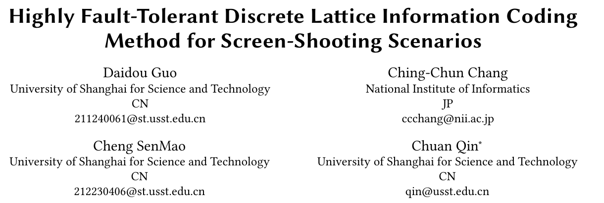

# Highly Fault-Tolerant Discrete Lattice Information Coding Method for Screen-Shooting Scenarios



**Daidou Guo, Ching-Chun Chang, Cheng SenMao, and Chuan Qin**  
*Proceedings of the 6th ACM International Conference on Multimedia in Asia (MMAsia '24)*, pp. 1–5, 2024.  
[Paper / DOI](https://doi.org/10.1145/3696409.3700285)

This repository is a laboratory-maintained release of inherited code associated with the paper. Its main `black_white` implementation maps a **32-bit message directly to a 400 × 400 black-and-white code image**, then learns to extract the message from the image. This is a standalone discrete-lattice code, not an invisible watermark embedded into a supplied photograph.

**Inference was checked with the supplied local encoder/decoder weights.** Four short messages were generated, saved to PNG, reloaded, and recovered with BCH correction. These were small, unmodified digital-image checks—not a screen-camera robustness benchmark.

All 15 inherited Python files are preserved byte-for-byte. A new [codec.py](codec.py) provides a portable CPU/BCH-2.x inference interface without modifying the network or the original scripts. See [validation and limitations](docs/VALIDATION.md). Model weights, datasets, `node_modules`, environments, logs, and experimental image collections are excluded from this release.

## Scope

- Main networks: `train code/black_white/model.py` (`Encoder`, `Decoder`).
- Message protocol: one or two ASCII bytes, padded to two bytes, followed by BCH parity; 32 network input/output bits in total.
- Output: a single-channel 400 × 400 binary code image, with pixel values 0 or 255 when saved.
- Retained experiments: original training script, a separate `model1.py`, noise/geometry helpers, Flask backend, and Vue frontend.
- Checked path: the new command-line codec using the inherited networks and supplied weights. The original long training entry and web application were **not** validated as ready-to-run applications.

## Repository layout

```text
.
├── codec.py                       # New portable inference wrapper
├── requirements.txt               # Main-path packages, excluding PyTorch
├── assets/paper_header.png
├── docs/
├── tests/test_codec.py
├── train code/
│   ├── black_white/
│   │   ├── model.py               # Main network definitions
│   │   ├── train.py               # Original CUDA-only, auto-start training entry
│   │   ├── encoder.py, decoder.py # Original web-oriented inference helpers
│   │   ├── model1.py              # Separate inherited experiment
│   │   ├── utils.py
│   │   ├── app.py
│   │   └── templates/index.html
│   ├── noise/                     # Original image-processing scripts
│   └── vue02/                     # Frontend source and package lock; no node_modules
└── GITHUB_UPLOAD_GUIDE_zh.md
```

The Vue source retains its small `src/assets/111_hidden.png` demonstration image, logo, and favicon because the source references them. They are not a dataset or a collection of generated results.

## Environment

Checked on **Windows / Python 3.8.18 / CPU**, with PyTorch **1.11.0+cu113**, NumPy **1.24.3**, Pillow **10.2.0**, and bchlib **2.1.3**. No GPU computation was used in this validation.

The local check used a new private virtual environment that reads the existing PyTorch stack. Only its missing `tensorboardX` and `bchlib` packages were installed into that new environment. No existing project environment was upgraded or uninstalled.

For a new installation, create a separate environment, install a suitable PyTorch build using the [official version instructions](https://pytorch.org/get-started/previous-versions/), then install this project's dependencies:

```text
conda create -n dlcode python=3.8 -y
conda activate dlcode
python -m pip install -r requirements.txt
```

These last commands must be run from the repository root, after PyTorch is installed. A completely fresh installation was not separately tested. See [DEPENDENCIES.md](docs/DEPENDENCIES.md) for the observed versions and optional legacy dependencies. Do not install into an unrelated working environment.

## External model weights

The codec requires these two **trusted PyTorch state dictionaries**:

```text
train code/black_white/model/
  encoder1.pth
  decoder1.pth
```

The inherited local files were approximately 87.4 MB and 45.7 MB, respectively, and loaded strictly into the supplied architectures. Their checksums are recorded in [VALIDATION.md](docs/VALIDATION.md). No public download link was supplied, so one is not invented here. Obtain matching authorized weights or use the original local assets.

Weights remain outside Git. You may place them in the default directory above, or use `--weights-dir` to read them from another location without copying them. The wrapper currently loads both files for all modes. PyTorch 1.11's loader unpickles files; do not supply untrusted checkpoints.

No COCO images are needed for inference: the encoder takes message bits, not a cover image. The inherited `dataset/COCO2014/` contains only an empty download note, and the active `black_white/train.py` generates its own random binary messages rather than reading that folder.

## Quick start

Run from the repository root with the dedicated interpreter/environment. With weights in the default directory:

```text
python codec.py roundtrip --secret cv --output-dir .local/output
```

This encodes `cv`, saves `.local/output/lattice.png`, reloads it, decodes it, and writes `.local/output/lattice_report.json`. Check `exact_text_recovery`, not just the process exit code. BCH failure is reported as a failed decoding result, not hidden as success.

To use weights stored elsewhere:

```text
python codec.py roundtrip --weights-dir "D:/your-local-models/dlcode" --secret hi --output-dir .local/output --name hi_code
```

Generate a code image without decoding:

```text
python codec.py encode --secret ab --output-dir .local/output --name ab_code
```

Decode an existing, already aligned code image:

```text
python codec.py decode --image .local/output/ab_code.png --output-dir .local/output --name recovered_ab
```

The wrapper defaults to `--device cpu --threads 2`. `--device cuda` is available only when the installed PyTorch/GPU setup supports it; it was not tested here. In PyCharm, select the dedicated interpreter, run `codec.py` with the arguments above, and use the repository root as the working directory.

The decoder converts input to grayscale and fits it to 400 × 400. It does **not** automatically locate, rectify, or recover a code from an arbitrary camera photograph. The retained corner/geometry scripts are separate experiments.

## Message protocol and outputs

The wrapper preserves the original text protocol: BCH polynomial **37**, correction setting **3**, and a 32-bit packet made from two payload bytes plus two parity bytes. It adapts the old constructor and `decode_inplace` calls to bchlib 2.1.3's `decode`/`correct` APIs. Messages longer than two ASCII bytes and non-ASCII text are rejected explicitly.

Encoding writes a grayscale PNG. Decoding writes/prints the predicted bits, BCH correction result, recovered text or `null`, and decoding status. Round-trip reports also compare the recovered text to the requested message. Outputs default to the gitignored `.local/` tree. The neural-network weights and architecture are unchanged.

## Training and web-demo limitations

**Do not import or casually run the original `train.py`: it immediately constructs CUDA models and starts 14,000 steps.** Its output names are `model/encoder.pth` and `model/decoder.pth`, not the `encoder1.pth` / `decoder1.pth` files expected by the old demo.

The supplied encoder uses a hard `torch.where` threshold. In the isolated optimizer check, **no encoder parameter received a gradient**, while decoder parameters updated. The active training function also has its noise-transform call commented out. Consequently, this release does not claim that the original script implements fully differentiable, end-to-end robust retraining. These scientific choices were not silently changed just to make a training claim.

The old Flask/Vue demo is retained as source, not a validated service: it contains fixed paths, a static frontend code image, and development-server settings. The original encoder writes to a previous-owner path and returns a placeholder string. Use `codec.py` for the checked inference workflow, and do not expose the old debug server publicly. See [KNOWN_ISSUES.md](docs/KNOWN_ISSUES.md).

## Verification

```text
python -m unittest discover -s tests -v
```

Four protocol tests passed without model weights. Pretrained-model checks recovered `cv`, `ab`, `hi`, and `A` after PNG saving/reloading. A separate decode CLI invocation recovered `cv`. Full datasets, noise sweeps, real screen-camera capture, full training, frontend build, and HTTP integration were not tested. Detailed scope is in [VALIDATION.md](docs/VALIDATION.md).

## Citation

Publication fields were checked against the supplied PDF and DOI registration record:

```bibtex
@inproceedings{guo2024discretelattice,
  author    = {Daidou Guo and Ching-Chun Chang and Cheng SenMao and Chuan Qin},
  title     = {Highly Fault-Tolerant Discrete Lattice Information Coding Method for Screen-Shooting Scenarios},
  booktitle = {Proceedings of the 6th ACM International Conference on Multimedia in Asia},
  year      = {2024},
  pages     = {1--5},
  doi       = {10.1145/3696409.3700285}
}
```

## License and uploading

No project-wide LICENSE was supplied; this preparation does not assign a new license or claim official-code status. Confirm laboratory authorization before public distribution. Existing source attributions are retained; see [THIRD_PARTY.md](docs/THIRD_PARTY.md).

For Windows CMD upload steps, use [GITHUB_UPLOAD_GUIDE_zh.md](GITHUB_UPLOAD_GUIDE_zh.md). Preparation did not create a remote repository, commit, or push.
